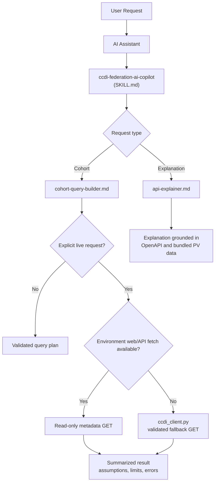

# CCDI Federation AI Skill Design (Current Implementation)

## Goal

Provide a reusable, metadata-only skill for CCDI Federation workflows with clear routing, explicit assumptions, and safe execution. The skill defaults to planning and explanation; it performs live requests only when the user explicitly asks.

Primary use cases:

- Cohort query planning and optional live execution
- Endpoint and response explanation
- Permissible-value (PV) normalization support

## Current Repository Structure

Relevant files in the current workspace:

```text
ccdi-federation-ai/
├── LICENSE
├── README.md
├── SECURITY.md
├── docs/
│   ├── agentskill-design.md
│   ├── instructions/
│   │   ├── chatgpt-instruction.md
│   │   ├── npx-skill-lifecycle.md
│   │   └── images/
│   ├── security/
│   │   └── snyk-pr-scan.md
└── skills/
    └── ccdi-federation-ai-copilot/
        ├── SKILL.md
        ├── agents/
        │   └── openai.yaml
        ├── references/
        │   ├── api-explainer.md
        │   ├── cohort-query-builder.md
        │   ├── openapi.yml
        │   └── pv/
        │       ├── file-pv-metadata.json
        │       ├── sample-pv-metadata.json
        │       └── subject-pv-metadata.json
        └── scripts/
            ├── ccdi_client.py
            ├── pv_mapper.py
            ├── test_ccdi_client.py
            ├── test_pv_mapper.py
            └── test_skill_guardrails.py
```

## Architecture Overview

### Runtime Model



### Design Principle

```text
SKILL.md + references = routing, policy, workflow, and response contracts
OpenAPI + bundled PV  = route/parameter and controlled-value sources of truth
Environment fetch     = preferred live metadata request capability
Python scripts        = guarded fallback client and PV metadata helpers
```

## Routing (Implemented)

`skills/ccdi-federation-ai-copilot/SKILL.md` currently routes to:

- Cohort requests, field/PV normalization, query plans, and live cohort fetches -> `references/cohort-query-builder.md`
- Endpoint, parameter, response, PV, pagination, relationship, or error explanations -> `references/api-explainer.md`
- Mixed requests start with the cohort workflow when identifying a cohort; otherwise start with the API explainer.

## Execution Policy (Implemented)

Execution policy for live API calls:

1. Live execution requires an explicit user request; otherwise provide a plan or explanation.
2. Use the environment's web/API fetching capability for metadata-only read requests when available.
3. Use `scripts/ccdi_client.py` only when that capability is unavailable.
4. If neither path is available, return the validated plan and explain the limitation.

Common constraints:

- Metadata-only scope
- Read-only metadata requests, normally `GET`
- Validate routes and parameters against the bundled `references/openapi.yml`
- Treat bundled PV JSON files as authoritative for controlled values; do not invent mappings
- Preserve assumptions, ambiguities, pagination limits, and page/node/API errors in responses
- Refuse raw-file delivery and bulk export/exfiltration workflows; summarize results rather than dumping full responses
- Do not send metadata exports outside the active workspace

## API Sources and Execution (Implemented)

- OpenAPI route, parameter, pagination, and response source: `references/openapi.yml`
- Controlled-value source: bundled `references/pv/{subject,sample,file}-pv-metadata.json`
- API base URL: `https://federation.ccdi.cancer.gov/api/v1/`
- Preferred live request path: environment web/API fetch capability
- Fallback request path: `scripts/ccdi_client.py`


The API explainer describes hub collection pagination using `page`, `per_page`, and node-level `summary.counts.current` / `summary.counts.all`. It explicitly avoids claiming that pagination is communicated through an HTTP `Link` header. The cohort workflow defaults to 10 results per page and at most 3 pages, stopping earlier when its documented termination conditions are met.

## Skill Workflow Contracts

### Cohort Query Builder

Defined in `skills/ccdi-federation-ai-copilot/references/cohort-query-builder.md`.

Current contract:

1. Interpret cohort intent
2. Identify entity scope (`subject`, `sample`, `file`, or cross-entity)
3. Normalize controlled values with PV metadata
4. Validate route and parameters against `./openapi.yml`
5. Execute live metadata calls only on explicit request, preferring environment fetch and using the Python client only as fallback
6. Return a concise summary with assumptions, ambiguities, limits, errors, sanity check, and suggested refinement

Current defaults:

- Page size default: 10
- Max pages default: 3
- Stop pagination on empty page, short page, missing/repeated token, error, or cap reached

### API Explainer

Defined in `skills/ccdi-federation-ai-copilot/references/api-explainer.md`.

Current contract:

- Explain endpoint purpose, methods, parameter usage, pagination, response shape, fields, relationships, and errors
- Validate route and parameter details against the local OpenAPI source
- Use bundled PV metadata as the authority for controlled-value details; the explainer permits the API wiki only as supplementary narrative context

## Python Fallback Scripts (Implemented)

### `scripts/ccdi_client.py`

- Allows only HTTPS requests to `federation.ccdi.cancer.gov` on the `/api/v1` base path; rejects credentials, non-default ports, query/fragment base URLs, and blocked hosts
- Allows only configured routes and query parameters (plus unharmonized filter parameters)
- Executes GET requests with a configurable timeout and retry count; redirects are rejected
- Returns a structured `{ok, url, status, payload, errors}` result and reports invalid JSON or request failures

### `scripts/pv_mapper.py`

- Loads bundled PV metadata for `file`, `sample`, and `subject`
- Lists controlled fields and retrieves a field's permissible values or metadata
- Checks whether a field/value pair is present

### Tests

The scripts directory includes unit tests for the API client and PV mapper, plus instruction guardrail tests for raw-file/exfiltration refusal, bounded cohort behavior, response sanity outputs, and pagination documentation.

## Notes and Scope Boundaries

- This implementation is intentionally lightweight and policy-driven; workflows are primarily encoded in Markdown rather than a local orchestration service.
- The skill's top-level instructions require clarification before acting on ambiguous requests. When evolving the skill, keep this alongside its live-execution and data-scope guardrails.
- The API explainer allows the API wiki as supplementary background, but bundled PV metadata remains authoritative and must not be overridden by external sources.
- Future modules must preserve metadata-only scope, bounded retrieval, and read-only execution.
